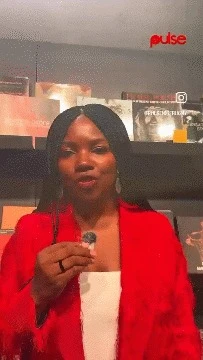

# Beyond event coverage: Pulse x ART X Lagos

A media partnership built around the people, ideas and creative voices shaping the African art ecosystem.

| | |
|---|---|
| **Role** | Developed and secured the partnership |
| **Partners** | Pulse and ART X Lagos |
| **Type** | Media partnership, editorial storytelling |
| **Timeline** | 2026, [ADD: dates] |

**TL;DR:** ART X Lagos is one of Africa's leading contemporary art platforms. I developed and secured a media partnership with Pulse, built around editorial storytelling rather than conventional event coverage. [ADD: the headline result, for example the stories published and their reach]

*Pulse at ART X Lagos. Watch the reel: https://www.instagram.com/reels/Dfb-gXpiNJj/*

## The opportunity

For Pulse, ART X Lagos was more than an art event to cover: it was a way into the ecosystem behind it. [ADD: what Pulse's arts and culture coverage lacked before this, and what Pulse wanted from the partnership]

For ART X Lagos, a partnership with Pulse offered [ADD: what the partner gained, for example reach into Pulse's audience or a new editorial format].

## The proposition: stories about people, not just highlights

Instead of pitching standard event coverage, I built the proposition around editorial storytelling: access to influential cultural voices and deeper stories about the people and ideas shaping African art. [ADD: why you chose this over standard coverage, and what convinced ART X Lagos]

<strong>Visual: Options explored</strong>

<strong>Show:</strong> One slide from your partnership proposal comparing standard event coverage with the editorial storytelling package you proposed, with what each side would get.

<strong>Why:</strong> Proves the strategic choice at the heart of this case study and shows how you framed value for both partners.

## My role

I developed the partnership opportunity and the alignment between both platforms, worked on the proposition and stakeholder engagement, and secured the partnership. [ADD: who you worked with at Pulse and at ART X Lagos, by role]

## The result

The media partnership between Pulse and ART X Lagos was secured, with an editorial approach built around people and ideas rather than event highlights.

[ADD: the content Pulse published through the partnership, with links, and any measured reach or engagement, with source]

[ADD: any proposed interviews or access opportunities that did not go ahead, labelled as proposed]

<strong>Visual: Before and after</strong>

<strong>Show:</strong> Two or three published Pulse stories or posts from the partnership, each with the creative voice featured and a short caption.

<strong>Why:</strong> Shows the editorial angle actually reached Pulse's audience, which is the outcome the case study claims.

<strong>Visual: Metric chart</strong>

<strong>Show:</strong> Reach or engagement for the partnership content compared with Pulse's usual event coverage, with dates and source.

<strong>Why:</strong> Tests whether the editorial approach outperformed conventional coverage, the core bet of the partnership.

## What I'd do differently

[ADD: one specific thing you would change about the partnership or the proposition, and why]

---

## Before you publish

Placeholders to fill, in order:

- [ ] [ADD: dates]
- [ ] [ADD: the headline result]
- [ ] [ADD: what Pulse's coverage lacked and what Pulse wanted]
- [ ] [ADD: what ART X Lagos gained]
- [ ] [ADD: why editorial over coverage, and what convinced the partner]
- [ ] [ADD: who you worked with]
- [ ] [ADD: published content with links and reach]
- [ ] [ADD: proposed items that did not go ahead]
- [ ] [ADD: one thing you would do differently]

Visuals to make (the sky blue boxes above):

- [ ] Options explored: proposal slide comparing coverage with the editorial package
- [ ] Before and after: published partnership stories
- [ ] Metric chart: partnership content reach versus usual coverage
