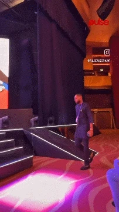

# Moonshot by TechCabal x Pulse: putting Pulse in the room

Connecting Pulse's media platforms with influential conversations across Africa's technology, business and creative ecosystem.

| | |
|---|---|
| **Role** | Coordinated the partnership from conception to execution |
| **Partner** | Moonshot by TechCabal |
| **Type** | Media partnership |
| **Year** | 2026 |

**TL;DR:** I coordinated a media partnership between Pulse and Moonshot by TechCabal from conception to execution, made sure every agreed deliverable was delivered, and positioned Pulse within the conversations shaping Africa's technology, business and creative ecosystem. [ADD: the headline result]

*Pulse on stage at Moonshot by TechCabal.*

## The context

Moonshot by TechCabal convenes conversations across Africa's technology, business and creative ecosystem. For Pulse, the partnership was a route into those industry conversations.

**The goal:** [ADD: what Pulse specifically wanted, for example a stage session or a content series]

For TechCabal, the partnership offered [ADD: what Moonshot gained].

## What I did

I coordinated the partnership from conception to execution: [ADD: the main steps, for example scoping the deal, agreeing deliverables, working with the teams on the day]. I made sure every agreed deliverable was delivered.

## What we delivered

- [ADD: deliverable one]
- [ADD: deliverable two]
- [ADD: deliverable three]

<strong>Visual: Content grid</strong>

<strong>Show:</strong> One photo or screenshot per deliverable, each captioned with what it was.

<strong>Why:</strong> Makes "every agreed deliverable" concrete.

## The result

Pulse was present at Moonshot and in the conversation, as captured on Pulse's Instagram.

[ADD: one outcome for Pulse, with source]

<strong>Visual: Published post screenshot</strong>

<strong>Show:</strong> Pulse's Moonshot post with its engagement visible.

<strong>Why:</strong> Gives the result a measurable trace.

## What I'd do differently

[ADD: one thing you learned or would change]

---

## Before you publish

- [ ] [ADD: the headline result]
- [ ] [ADD: the goal]
- [ ] [ADD: what TechCabal gained]
- [ ] [ADD: the main coordination steps]
- [ ] [ADD: the deliverables]
- [ ] [ADD: one outcome, with source]
- [ ] [ADD: one thing you would do differently]

Visuals to make (the sky blue boxes above):

- [ ] Content grid: one image per deliverable
- [ ] Published post screenshot with engagement
