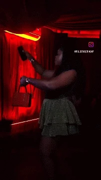

# The House x Pulse x Lagos Fashion Week: two curated nights for creators

Two curated events at The House during Lagos Fashion Week, bringing Pulse Creator Collective into the moment.

| | |
|---|---|
| **Role** | Developed the collaboration |
| **Partners** | The House, Pulse Creator Collective, Lagos Fashion Week |
| **Drinks partner** | Macallan |
| **Year** | 2026 |

**TL;DR:** I developed a collaboration between The House, Pulse Creator Collective and Lagos Fashion Week that became two events at The House: The Fashion Insider Dinner with Kisara, and The House x Pulse Fashion Week Closing Party. Macallan joined as the drinks partner. Pulse Creator Collective attended, alongside 100+ creators, designers and fashion enthusiasts.

*The House x Pulse Fashion Week Closing Party.*

## The context

The House is a Lagos space with a restaurant that hosts curated events. Lagos Fashion Week is a meeting point for fashion, culture and media. The opportunity was to bring The House and Pulse Creator Collective into that moment together.

**The goal:** [ADD: what Pulse wanted for Pulse Creator Collective from this collaboration]

## What I did

I developed the collaboration between The House, Pulse Creator Collective and Lagos Fashion Week. I identified the shared audience, [ADD: who that audience is], aligned the opportunity with Pulse's creators platform, and extended the relationship into two experiences.

[ADD: why a dinner and a closing party, and what each was for]

## The events

1. **The Fashion Insider Dinner with Kisara**, hosted at The House.
2. **The House x Pulse Fashion Week Closing Party**, hosted at The House.

Macallan joined as the drinks partner.

<strong>Visual: Before and after pair</strong>

<strong>Show:</strong> One photo from the Fashion Insider Dinner beside one from the Closing Party, each captioned with its format and guests.

<strong>Why:</strong> Shows that the collaboration delivered two distinct experiences, not one.

## The result

Pulse Creator Collective attended, alongside 100+ creators, designers and fashion enthusiasts [ADD: across both events, or name the event].

[ADD: one further outcome, for example content the Collective published or a follow-on with The House]

<strong>Visual: Content grid</strong>

<strong>Show:</strong> Posts from Pulse Creator Collective members at the events.

<strong>Why:</strong> Shows what the creators produced, the outcome beyond attendance.

## What I'd do differently

[ADD: one thing you learned or would change]

---

## Before you publish

- [ ] [ADD: the goal]
- [ ] [ADD: who the shared audience is]
- [ ] [ADD: why a dinner and a party]
- [ ] [ADD: which event the 100+ figure covers]
- [ ] [ADD: one further outcome]
- [ ] [ADD: one thing you would do differently]

Visuals to make (the sky blue boxes above):

- [ ] Dinner and party photo pair
- [ ] Content grid of creator posts
