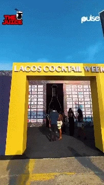
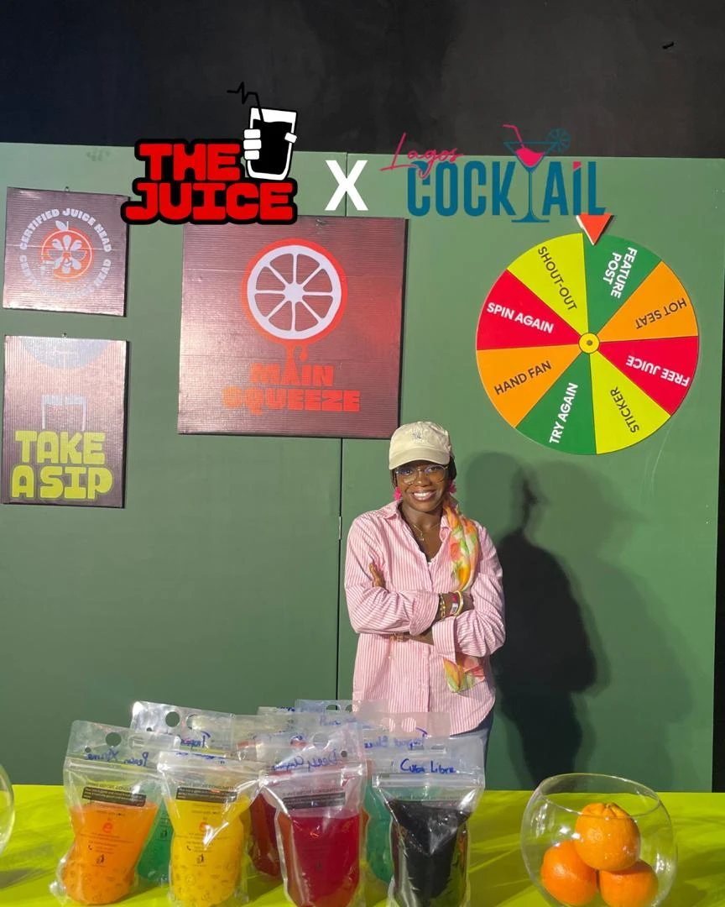

# A booth people played, not passed: The Juice x Lagos Cocktail Week

Taking a digital lifestyle community beyond the screen and into a shared cultural experience.

| | |
|---|---|
| **Role** | Led the partnership activation |
| **Partners** | The Juice (Pulse) and Lagos Cocktail Week |
| **Format** | Branded booth with a spin-the-wheel game, Cocktail Village |
| **Timeline** | 2026, [ADD: activation dates] |

**TL;DR:** The Juice is Pulse's pop culture newsletter. I led the activation that brought it to Lagos lovers of lifestyle, cocktails and nightlife at Cocktail Village, with a spin-the-wheel game at the centre of the booth. We gained 100+ newsletter subscribers, and The Juice's Instagram grew from ~300 to 565 followers during the activation period.

*The Juice and Pulse at Lagos Cocktail Week. Watch the reel: https://www.instagram.com/reels/De1WVp2IsPk/*

## The goal

Bring The Juice's digital community into an existing community of Lagos lifestyle, cocktail and nightlife lovers. At Cocktail Village we could introduce the brand, let people interact with us, and get them to subscribe to the newsletter.

For Lagos Cocktail Week, the partnership offered [ADD: what the festival gained, for example coverage on Pulse or access to The Juice's readers].

## The idea: a game, not a stand

The centrepiece was a spin-the-wheel game. Attendees spun the wheel for a chance to win prizes: free mocktails at our stand, a feature post on The Juice, and other fun extras. Every spin was a chance to introduce The Juice, talk to people and invite them to subscribe.

[ADD: one sentence on why you chose a game over sampling or a photo moment]

*The Juice booth at Cocktail Village: the prize wheel, booth signage and cocktail pouches.*

<strong>Visual: Interaction sequence</strong>

<strong>Show:</strong> An attendee spinning the wheel, the prize they won, and a feature post that later ran on The Juice.

<strong>Why:</strong> Shows the game connecting the physical booth to The Juice's platforms, the core idea of this case study.

## My role

I led the partnership activation and worked across planning, brand experience and execution of The Juice's presence at Cocktail Village, building the booth experience around the game. [ADD: who you worked with at Pulse and Lagos Cocktail Week]

## The result

- **100+** new newsletter subscribers.
- The Juice's Instagram grew from **~300 to 565** followers during the activation period, **+88.3%**, alongside its regular content.

[ADD: activation dates and the source for each figure, for example the newsletter platform and Instagram Insights]

<strong>Visual: Metric chart</strong>

<strong>Show:</strong> Newsletter subscribers and Instagram followers across the activation period, with the Cocktail Village days shaded.

<strong>Why:</strong> Shows when the growth happened relative to the booth, the honest way to connect it to the activation.

## What I'd do differently

[ADD: one specific change, for example capturing sign-ups on the spot at the wheel, and why]

---

## Before you publish

Placeholders to fill, in order:

- [ ] [ADD: activation dates]
- [ ] [ADD: what Lagos Cocktail Week gained]
- [ ] [ADD: why a game]
- [ ] [ADD: who you worked with]
- [ ] [ADD: dates and source for each figure]
- [ ] [ADD: one thing you would do differently]

Visuals to make (the sky blue boxes above):

- [ ] Interaction sequence: spin, prize, feature post
- [ ] Metric chart: subscribers and followers across the activation period
